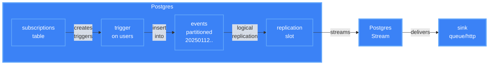

# How It Works

## Overview

Events are inserted into `pgstream.events` and streamed via logical replication to your sink.

**Two ways to create events:**

1. **Subscriptions** (optional) - Define triggers that automatically capture table changes
2. **Manual inserts** - Insert directly into `pgstream.events` from your application

See [Manual Events](manual-events.md) for the direct insert approach.



## Why This Approach?

Postgres Stream uses logical replication, but subscribes only to the `events` table instead of your application tables.

Traditional CDC reads application tables directly:

- WAL retention grows if the sink is slow
- Slot invalidation = data loss
- Recovery depends on WAL availability
- Destination must be highly available (e.g. Kafka cluster) to avoid data loss

But we only care about the events we subscribed to, and do not want to replicate your entire database! By streaming from a single partitioned `events` table, we get:

- WAL released immediately after event written
- Events table provides durability (7-day retention)
- Recovery reads from the table, not WAL
- Slot invalidation triggers automatic recovery
- Destination can be simple (single webhook, Redis instance) - no HA required

## Subscriptions (Optional)

Subscriptions come from a [user-installed SQL package](../guides/subscription-setup.md). When you insert a subscription, that package creates a trigger on the target table; the pgstream daemon does not manage application-table triggers:

```sql
-- Auto-generated when you insert into subscriptions table
create or replace function pgstream_subscriptions._publish_after_insert_on_users()
returns trigger as $$
declare
  v_jsonb_output jsonb := '[]'::jsonb;
  v_base_payload jsonb := jsonb_build_object(
    'tg_op', tg_op,
    'tg_table_name', tg_table_name,
    'tg_table_schema', tg_table_schema,
    'timestamp', (extract(epoch from now()) * 1000)::bigint
  );
begin
  -- Check subscription "user-signup" condition
  if new.email_verified = true then
    v_jsonb_output := v_jsonb_output || (jsonb_build_object(
      'tg_name', 'user-signup',
      'new', jsonb_build_object('id', new.id, 'email', new.email),
      'old', null
    ) || v_base_payload);
  end if;

  -- Write to events table if any subscriptions matched
  if jsonb_array_length(v_jsonb_output) > 0 then
    insert into pgstream.events (payload, stream_id)
    select elem, 1
    from jsonb_array_elements(v_jsonb_output) as t(elem);
  end if;

  return new;
end;
$$ language plpgsql;
```

The actual generated code handles multiple subscriptions per table, merges `when` clauses with OR logic, and includes all payload extensions.

## Event Flow

1. **Event written** - Via subscription trigger or direct insert into `pgstream.events`
2. **Logical replication** - Postgres Stream receives the event
3. **Sink delivery** - Event delivered to your configured sink

## Partitioned Events Table

Events are stored in a partitioned table with daily partitions:

- **7-day retention** by default
- **Automatic partition creation** 7 days ahead
- **Automatic partition cleanup** for old data
- Partitioning keeps the table fast and manageable

## Database Objects

On startup, Postgres Stream migrates two schemas in your database:

- **`pgstream`** - The events table, stream state, and the publication per stream.
- **`etl`** - Replication state of the underlying [supabase/etl](https://github.com/supabase/etl) library, plus two helper functions it calls at runtime: `etl.describe_table_schema` and `etl.describe_table_identity`.

etl normally installs these helpers together with a `ddl_command_end` event trigger (`supabase_etl_ddl_message_trigger`) that propagates schema changes. Creating an event trigger requires superuser, which managed Postgres providers do not grant. Postgres Stream therefore skips etl's source migrations and installs only the two helper functions through its own migrations. No event trigger is created.

etl still needs to learn about schema changes of `pgstream.events`. Postgres Stream's own migrations announce them by calling `pgstream.emit_events_schema_change()`, which emits the same logical message as etl's trigger without superuser. If you alter `pgstream.events` yourself, call it in the same transaction, after the change:

```sql
begin;
alter table pgstream.events add column tenant_id text;
select pgstream.emit_events_schema_change();
commit;
```

Other tables, such as `pgstream.subscriptions`, are not replicated and can be altered freely, as can defaults, indexes and partitions of `pgstream.events`.

### Schema Changes of the Events Table

An unannounced change of the columns of `pgstream.events` makes replication fail with `CorruptedTableSchema` on every restart: replicated rows carry columns etl does not know. Calling `pgstream.emit_events_schema_change()` afterwards does not help, because the pipeline resumes from before the change. Recreate the slot instead, which makes etl read the current schema, and replay the events from the events table:

1. Stop Postgres Stream.
2. Run, with `<id>` the stream id:

   ```sql
   begin;
   -- replay from before the first event the slot has not confirmed; the 16 MB margin covers
   -- event lsns, which are taken from the WAL write position and can lag behind
   update pgstream.streams
   set slot_recovery_lsn = (
     select restart_lsn - 16777216 from pg_replication_slots
     where slot_name = 'supabase_etl_apply_<id>'
   )
   where id = <id>;
   delete from etl.replication_state where pipeline_id = <id>;
   commit;
   select pg_drop_replication_slot('supabase_etl_apply_<id>');
   ```

3. Start Postgres Stream. etl creates a new slot and reads the current schema, and the events from `slot_recovery_lsn` on are replayed, so some may be delivered twice.

## Next Steps

- [Subscriptions](subscriptions.md) - Auto-capture table changes
- [Manual Events](manual-events.md) - Direct event insertion
- [Event Structure](event-structure.md) - Payload and metadata format
